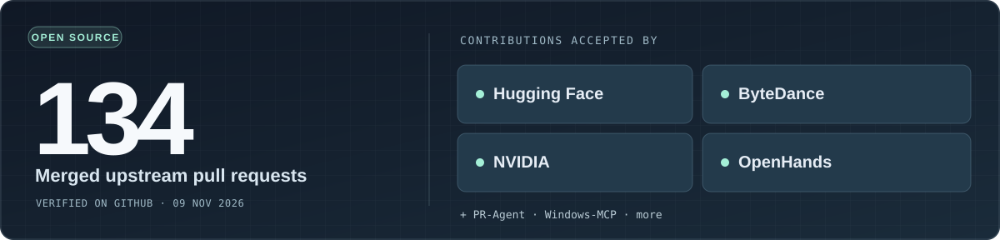

 

**AI coding systems · Verified automation · Local-first software**

[Open source](#open-source) &nbsp;·&nbsp; [Selected builds](#selected-builds) &nbsp;·&nbsp; [Trebell Code](https://trebell.dev)

 

## Open source

**Selected merged fixes:** [Hugging Face · model dtype](https://github.com/huggingface/sentence-transformers/pull/4314) &nbsp;·&nbsp; [ByteDance · async compaction](https://github.com/bytedance/deer-flow/pull/7806) &nbsp;·&nbsp; [NVIDIA · detection](https://github.com/NVIDIA/SkillSpector/pull/965) &nbsp;·&nbsp; [OpenHands · interface](https://github.com/OpenHands/OpenHands/pull/18936)

[View all merged upstream PRs](https://github.com/pulls?q=is%3Apr+is%3Amerged+author%3Atanishqbaweja+-user%3Atanishqbaweja). Count verified 9 Nov 2026; excludes PRs to my own repositories.

## Selected builds

<table>
<tr>
<td width="50%" valign="top">

**[Trebell Code](https://trebell.dev)** · [Code](https://github.com/tanishqbaweja/TrebCode) · [Benchmarks](https://github.com/tanishqbaweja/TrebCode/blob/main/BENCHMARKS.md)

My own agentic coding harness. Built to optimize **verified engineering work per dollar**.

</td>
<td width="50%" valign="top">

**[VerityMCP](https://github.com/tanishqbaweja/VerityMCP)**

Computer-use tools for ChatGPT, with **verification of real file, terminal, browser, and desktop actions**.

</td>
</tr>
<tr>
<td width="50%" valign="top">

**[PDFOmni](https://pdfomni.com)** · [Code](https://github.com/tanishqbaweja/pdfomni)

**Private, in-browser** PDF editing and tools, including non-rasterizing content edits.

</td>
<td width="50%" valign="top">

**[Within](https://github.com/tanishqbaweja/fileconverter)**

Browser-native file conversion. **No upload server**, with [388 verified routes](https://github.com/tanishqbaweja/fileconverter#verified-public-routes).

</td>
</tr>
</table>

[**Explore my repositories**](https://github.com/tanishqbaweja?tab=repositories) &nbsp;·&nbsp; [**See Trebell Code**](https://trebell.dev) &nbsp;·&nbsp; [**Browse merged contributions**](https://github.com/pulls?q=is%3Apr+is%3Amerged+author%3Atanishqbaweja+-user%3Atanishqbaweja)

