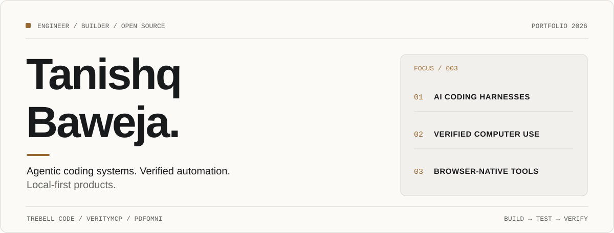
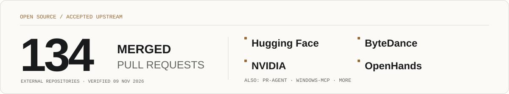
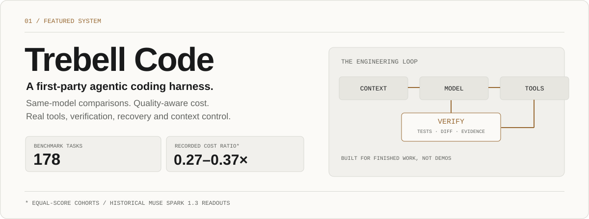
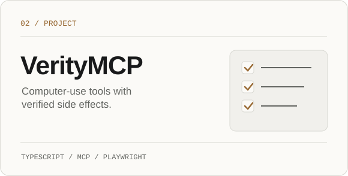
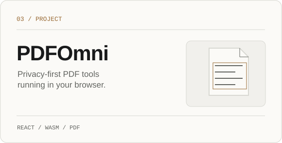
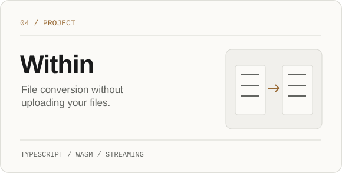
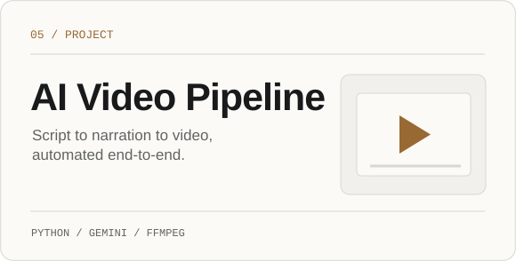

<picture><source media="(prefers-color-scheme: dark)" srcset="assets/v2-hero-dark.svg"></picture>

  <a href="#trebell-code">Trebell Code</a> &nbsp;·&nbsp;
  <a href="#selected-work">Projects</a> &nbsp;·&nbsp;
  <a href="#open-source">Open source</a> &nbsp;·&nbsp;
  <a href="#connect">Connect</a>

<a href="https://github.com/pulls?q=is%3Apr+is%3Amerged+author%3Atanishqbaweja+-user%3Atanishqbaweja"><picture><source media="(prefers-color-scheme: dark)" srcset="assets/v2-oss-dark.svg"></picture></a>

## Trebell Code

<a href="https://trebell.dev"><picture><source media="(prefers-color-scheme: dark)" srcset="assets/v2-trebell-dark.svg"></picture></a>

  <a href="https://trebell.dev">Website</a> &nbsp;·&nbsp;
  <a href="https://github.com/tanishqbaweja/TrebCode">Source</a> &nbsp;·&nbsp;
  <a href="https://github.com/tanishqbaweja/TrebCode/blob/main/BENCHMARKS.md">Benchmarks &amp; methodology</a>

The cost comparison is from four recorded Muse Spark 1.3 readouts, using the same model and effort. Ratios apply to <strong>equal-score task cohorts</strong>, not all runs; configurations and outcomes differed. Full results, limitations, and task-level evidence are linked above.

## Selected work

  <a href="https://github.com/tanishqbaweja/VerityMCP"><picture><source media="(prefers-color-scheme: dark)" srcset="assets/v2-verity-dark.svg"></picture></a>
  <a href="https://pdfomni.com"><picture><source media="(prefers-color-scheme: dark)" srcset="assets/v2-pdfomni-dark.svg"></picture></a>

  <a href="https://github.com/tanishqbaweja/fileconverter"><picture><source media="(prefers-color-scheme: dark)" srcset="assets/v2-within-dark.svg"></picture></a>
  <a href="https://github.com/tanishqbaweja/AIVideoMaker"><picture><source media="(prefers-color-scheme: dark)" srcset="assets/v2-video-dark.svg"></picture></a>

<a href="https://github.com/tanishqbaweja/VerityMCP">VerityMCP source</a> &nbsp;·&nbsp;
<a href="https://github.com/tanishqbaweja/pdfomni">PDFOmni source</a> &nbsp;·&nbsp;
<a href="https://github.com/tanishqbaweja/fileconverter">Within source</a> &nbsp;·&nbsp;
<a href="https://github.com/tanishqbaweja/AIVideoMaker">AI Video Pipeline source</a>

## Open source

<strong>134 merged upstream PRs.</strong> Real contributions to other maintainers' repositories, not just my own forks. <a href="https://github.com/pulls?q=is%3Apr+is%3Amerged+author%3Atanishqbaweja+-user%3Atanishqbaweja">Explore the merged PRs</a>.

<b>Selected accepted contributions</b> · 6 examples

- [Hugging Face / sentence-transformers](https://github.com/huggingface/sentence-transformers/pull/4314) — restore Router model dtype compatibility
- [ByteDance / deer-flow](https://github.com/bytedance/deer-flow/pull/7806) — prevent blocking during manual compaction
- [NVIDIA / SkillSpector](https://github.com/NVIDIA/SkillSpector/pull/965) — fix false positives in prompt-extraction detection
- [OpenHands](https://github.com/OpenHands/OpenHands/pull/18936) — preserve template filtering scroll
- [oh-my-claudecode](https://github.com/Yeachan-Heo/oh-my-claudecode/pull/4890) — correct MCP profile configuration isolation
- [Windows-MCP](https://github.com/CursorTouch/Windows-MCP/pull/550) — fix desktop window traversal ordering

Count verified via GitHub's merged-PR search on 9 November 2026.

## Connect

  <a href="https://trebell.dev"><strong>Trebell Code</strong></a> &nbsp;·&nbsp;
  <a href="https://pdfomni.com"><strong>PDFOmni</strong></a> &nbsp;·&nbsp;
  <a href="https://github.com/tanishqbaweja?tab=repositories"><strong>All repositories</strong></a>

