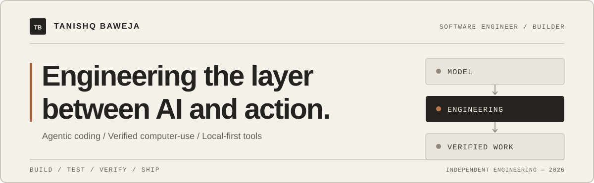
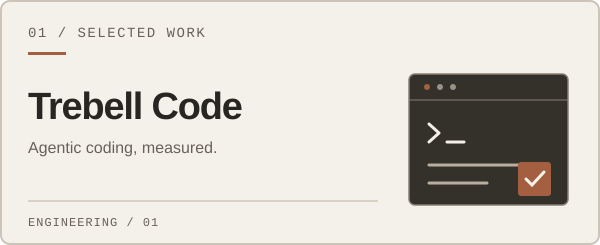
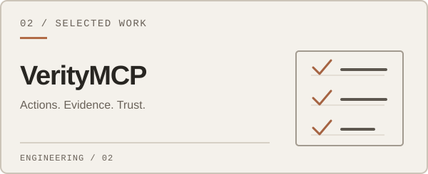
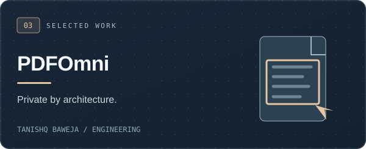
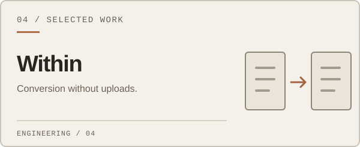

 

**Software engineer · Independent builder · Open-source contributor**

[**Open source · 134 merged PRs**](#open-source-contributions) &nbsp;·&nbsp; [**Trebell Code**](https://trebell.dev) &nbsp;·&nbsp; [**Selected work**](#selected-work) &nbsp;·&nbsp; [**PDFOmni**](https://pdfomni.com)

 

## Open-source contributions

**Not just forks. Changes reviewed, accepted, and merged into other people's projects.**

<table>
<tr>
<td width="34%" valign="top" align="center">
 
MERGED UPSTREAM PULL REQUESTS
<h1>134</h1>
<strong>Real changes in external repositories</strong>
  
<a href="https://github.com/pulls?q=is%3Apr+is%3Amerged+author%3Atanishqbaweja+-user%3Atanishqbaweja"><strong>Browse the merged PRs ↗</strong></a>
  
GitHub search · verified 9 Nov 2026
  
</td>
<td width="66%" valign="top">

I contribute across **AI infrastructure, developer tools, automation, and open-source applications**. These are upstream contributions to maintainers' original repositories, not commits to my own forks.

**Examples of projects that have merged my work:**

[Hugging Face · sentence-transformers](https://github.com/huggingface/sentence-transformers/pull/4314) · [ByteDance · deer-flow](https://github.com/bytedance/deer-flow/pull/7806) · [NVIDIA · SkillSpector](https://github.com/NVIDIA/SkillSpector/pull/965) · [OpenHands](https://github.com/OpenHands/OpenHands/pull/18936) · [PR-Agent](https://github.com/The-PR-Agent/pr-agent/pull/4648) · [Windows-MCP](https://github.com/CursorTouch/Windows-MCP/pull/550)

</td>
</tr>
</table>

**Selected merged contributions**

| Upstream repository | Engineering contribution |
| :--- | :--- |
| **[Hugging Face / sentence-transformers](https://github.com/huggingface/sentence-transformers/pull/4314)** | Fixed Router module dtype handling to restore float16 and bfloat16 compatibility. |
| **[ByteDance / deer-flow](https://github.com/bytedance/deer-flow/pull/7806)** | Moved manual-compaction model construction off the event loop, avoiding blocking the async runtime. |
| **[NVIDIA / SkillSpector](https://github.com/NVIDIA/SkillSpector/pull/965)** | Fixed false prompt-extraction reports on Python return statements. |
| **[OpenHands / OpenHands](https://github.com/OpenHands/OpenHands/pull/18936)** | Preserved template-filter scrolling when a search returns no results. |
| **[oh-my-claudecode](https://github.com/Yeachan-Heo/oh-my-claudecode/pull/4890)** | Corrected MCP config isolation for custom Claude profile directories. |
| **[Windows-MCP](https://github.com/CursorTouch/Windows-MCP/pull/550)** | Improved desktop UI-tree window traversal using Windows z-order. |

Every example links to its merged pull request. The 134 count covers upstream merged PRs, not the number of repositories or a claim of maintainership. [Complete merged-PR history](https://github.com/pulls?q=is%3Apr+is%3Amerged+author%3Atanishqbaweja+-user%3Atanishqbaweja).

---

### The work matters more than the buzzwords.

I build software at the point where AI stops generating answers and starts **getting things done**. My focus is on the engineering around the model: tool execution, context, caching, reliable automation, verification, and thoughtful products people can actually use.

That means building my own coding-agent harness, making computer-use actions verifiable, and creating privacy-first tools that process files on your device.

<table>
  <tr>
    <td width="33%" align="center">
      <h2>178</h2>
      <strong>Recorded engineering tasks</strong> 
      Trebell / Muse Code benchmark
    </td>
    <td width="34%" align="center">
      <h2>0.27–0.37×</h2>
      <strong>Relative model cost</strong> 
      Across equal-score benchmark cohorts
    </td>
    <td width="33%" align="center">
      <h2>388</h2>
      <strong>Verified conversion routes</strong> 
      Within · browser file converter
    </td>
  </tr>
</table>

**Evidence, not marketing:** The cost range comes from four historical readouts using the same Muse Spark 1.3 model and reasoning effort. It applies to recorded **equal-score task cohorts**, not every task or every model; the runs used different Trebell Native snapshots, and the harnesses did not resolve precisely the same tasks. [Read the methodology, limitations, and task-level evidence](https://github.com/tanishqbaweja/TrebCode/blob/main/BENCHMARKS.md). Within's published conversion routes are documented in [its capability registry](https://github.com/tanishqbaweja/fileconverter#verified-public-routes).

---

## Selected work

<table>
<tr>
<td width="50%" valign="top">

**[Trebell Code](https://github.com/tanishqbaweja/TrebCode)** · [Website](https://trebell.dev) · [Benchmark](https://github.com/tanishqbaweja/TrebCode/blob/main/BENCHMARKS.md)

A desktop agentic coding environment with a **first-party model/tool harness**. I work on making the same AI model do more verified engineering work per dollar through cache-aware context, lazy tools, self-checks, and measured recovery. It also integrates external coding runtimes, but the native harness is the core.

Electron · React · Node.js · LLM APIs · agent orchestration

</td>
<td width="50%" valign="top">

**[VerityMCP](https://github.com/tanishqbaweja/VerityMCP)** · [Source](https://github.com/tanishqbaweja/VerityMCP)

A Model Context Protocol server that lets ChatGPT work with real **local files, terminals, browsers, and desktop applications**. Its defining idea: successful tool calls must be backed by checks of what actually changed, not just optimistic responses.

TypeScript · MCP · Playwright · filesystem and process tooling

</td>
</tr>
<tr>
<td width="50%" valign="top">

**[PDFOmni](https://github.com/tanishqbaweja/pdfomni)** · [Use the app](https://pdfomni.com)

A local-first PDF toolkit built around **in-browser processing**. Its editor works with underlying PDF content rather than relying on flattening pages into images, with the aim of keeping text and vector content intact.

React · WebAssembly · JavaScript · PDF internals

</td>
<td width="50%" valign="top">

**[Within](https://github.com/tanishqbaweja/fileconverter)** · [Verified capabilities](https://github.com/tanishqbaweja/fileconverter#verified-public-routes)

A privacy-first browser file converter that processes files in workers and streams results directly to user-selected destinations. Its conversion matrix is backed by repeatability, output validation, cleanup, and memory checks.

TypeScript · WebAssembly · FFmpeg · browser streaming

</td>
</tr>
</table>

  
<strong>See Trebell Code in action</strong>

   
  
  
Actual product screenshot from the public Trebell Code repository.

## A few principles

**Measure the result, not the demo.** A coding agent is only useful if the code works. A cheaper agent is only better when quality is accounted for.

**Verify the side effect.** If a tool says it changed a file, ran a test, or clicked a button, that claim should be checkable.

**Keep complexity behind the product.** Powerful engineering is worth little if the user has to think about every implementation detail.

## Beyond the flagship projects

I also build [automated AI video production systems](https://github.com/tanishqbaweja/AIVideoMaker) and explore [native mobile product design](https://github.com/tanishqbaweja/LocalMusicPlayer). Different mediums, same interest: taking an ambitious idea all the way to a working system.

---

**Interested in developer infrastructure, agent reliability, or local-first software?**

Take a look at [Trebell Code](https://trebell.dev), explore the [repositories](https://github.com/tanishqbaweja?tab=repositories), or [reach out through GitHub](https://github.com/tanishqbaweja).

Built, tested, and maintained by Tanishq Baweja.

